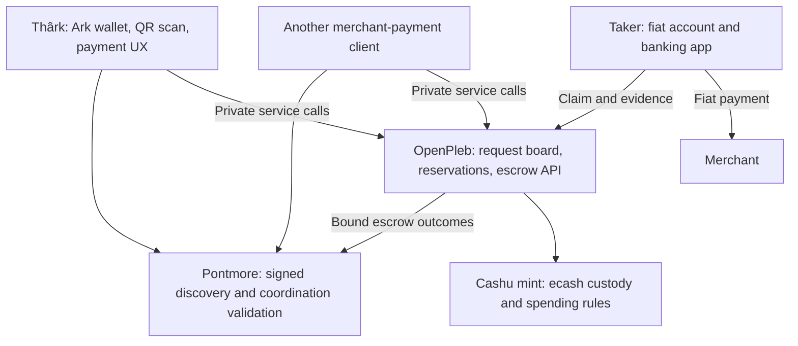

# OpenPleb, Pontmore, and Thârk: interoperability research

Research snapshot: 25 October 2026. This is a source-based architecture assessment and proposed integration path, not an adopted protocol or a funded integration test.

**Recommendation:** make OpenPleb an optional Pontmore-discoverable payment and escrow service, and make Thârk a client that can select that service. Preserve OpenPleb's banking knowledge and taker workflow. Introduce participant-signed coordination at the point where a particular payer and taker agree. Start with explicit customer confirmation and the existing custody model; investigate different custody mechanisms separately.

The important profile distinction is that OpenPleb pays a third-party merchant. The current `pontmore/swap@1` assigns fiat receipt and confirmation to one of the two trade participants. Its timeout rules also differ from OpenPleb's. A faithful integration therefore needs an experimental merchant-payment profile, or an explicit adopted extension to the swap profile. Renaming database statuses is insufficient.

## Evidence and limits

| Source | Revision checked | What it establishes |
| --- | --- | --- |
| [OpenPleb upstream][op-tree] | `f4c91e10d1e0e4c7d841a0a6b2232d9b15b8e756`, default branch `master`; commit dated 12 March 2026 | Source behavior of the upstream implementation |
| [Thârk][th-tree] | `fb3d44d93290be585259998d67ee4035adc7f316`, default branch `main`; commit dated 22 October 2026 | Mobile integration, wallet operations, and API assumptions |
| [Pontmore protocol][pm-tree] | `edcf1370e7e646574021709cc9b186d96377280a`, default branch `main`; commit dated 5 October 2026 | Current merged protocol, including draft/experimental status |
| [Pontmore offers PR #28][pm-offers] | Open and unmerged; head `31224d4dc7ad8e922b17a8d3c03d36cbd47d5356` | Proposed NIP-69 standing offers, not current main behavior |
| [OpenPleb issue #11][op-upload], [PR #12][op-skip] | Issue and proposed upload fallback remain open | A reported failure after fiat payment and a proposed mitigation |
| Local `../pontmore-ts` | Inspected local working files; no committed branch head or configured remote | An experimental implementation candidate, not a public mobile SDK release |

Git remote heads were refreshed for all three public repositories. GitHub issues, repository metadata, and Thârk's public release were inspected. Thârk has a [first public beta][th-release], published 21 October 2026. OpenPleb's README explicitly says it is under construction and not production ready. Neither publication nor working source establishes liquidity, uptime, safe custody, or completed transactions.

Thârk hardcodes `https://2-58-82-83.sslip.io` as its OpenPleb endpoint. I could not retrieve its public API schema: the local network path failed DNS resolution and the web tool could not access it. This is an observation about this research environment, not proof that the service is down. The deployed backend revision, configuration, funds, activity, and modifications remain unverified. There are definite differences between the upstream routes and Thârk's client assumptions, discussed below. No customer records, receipts, or tokens were fetched, and no live transactions were initiated.

## 1. What OpenPleb actually provides

OpenPleb is a marketplace for delegated fiat payments: a customer funds a request in bitcoin; another person pays the customer's banking QR and receives bitcoin. Its [monorepo][op-readme] contains a Bun/Elysia backend, SvelteKit customer and administration frontends, a shared TypeScript package, PostgreSQL/Drizzle persistence, and Cashu wallet operations.

The operational roles are:

- **Maker:** wants the banking QR paid, funds principal, fees, and a bond.
- **Taker:** posts another bond, pays the QR externally, submits a receipt, receives bitcoin.
- **Operator:** hosts the market, holds spendable ecash proofs, runs deadlines and payouts, and administers disputes.
- **Mint:** custodies the bitcoin backing the ecash and enforces supported Cashu spending conditions.
- **Merchant/payee:** receives the fiat outside OpenPleb. Usually has no OpenPleb identity or signing key.

The server is the authoritative coordinator in the inspected implementation. There is no participant-signed Nostr event chain, cross-instance market federation, or independently replayable public history in that source.

### 1.1 Matching is a funded request board

The maker posts arbitrary QR data, an amount, a pubkey, and optionally a provider ID. The server calculates sats and fees from its configured currency and exchange rate, stores an offer, and supplies a Cashu mint's Lightning invoice. It also supports direct ecash funding. Funded offers become `INVOICE_PAID` and appear in the market. [Creation][op-create], [invoice][op-invoice], [ecash funding][op-token-funding].

Takers choose offers manually. The [claim handler][op-claim] receives a pubkey and an exact-value Cashu bond, redeems the bond, creates a claim, and sets `CLAIMED`. A unique database constraint limits stored claims to one per offer, but is not itself a complete concurrency/recovery protocol.

Thârk's [Earn screen][th-earn] polls every five seconds and filters available offers by `INVOICE_PAID`. It displays THB amount, reward, bond, and time remaining. Its client also registers for new-offer push notifications. This is not an automatic matching algorithm or a market maker. Takers need access to the relevant fiat rail, a balance on that rail, and bitcoin for the bond.

Different instances can configure different currencies and provider labels, but that does not create shared liquidity. Upstream has no verified protocol for making one request claimable across several instances without duplicate payment.

### 1.2 The escrow is operator-controlled during the trade

In [checkInvoiceState][op-funding], the backend calls `mintProofs` without participant lock conditions and stores the resulting secrets and signatures in `proofsTable`. The taker's bond is likewise received into the backend wallet. The operator can spend this working ecash; the mint separately controls redemption.

At payout, [handlePayouts][op-payout] swaps those proofs into P2PK outputs for the maker and taker. At refund, [handleExpiry][op-refund] creates a P2PK token for the maker. These recipient locks protect the **issued payout or refund**, not the funds throughout the preceding trade. They are not a pre-funded maker/taker/resolver multisig escrow.

[Cashu NUT-11][nut11] makes the mint responsible for enforcing P2PK conditions. Mint support and behavior must therefore be validated. A mint URL and syntactically valid token are not enough.

Once Thârk receives a refund or reward token, its [OpenPleb module][th-api] can redeem it directly with the mint: it creates a Lightning invoice for its Ark wallet and melts the ecash into that invoice. That removes the OpenPleb operator from this redemption step. It does not remove the need for the operator to generate and deliver the token first, or for the mint to remain operational.

Thârk also has a fallback through a second mint when the first rejects an Ark invoice. This adds another mint dependency and fee path; it is wallet interoperability, not Pontmore coordination interoperability.

### 1.3 Economics and bond accounting

Let `S` be principal in sats, `T` the taker fee, `P` the platform fee, and `B` the bond required from each side. The percentage fields stored in an offer are already calculated satoshi amounts, despite their names.

| Stage/outcome | Maker | Taker | Operator/remaining ecash |
| --- | --- | --- | --- |
| Funding | Pays `S + T + P + B` | Pays `B` on claim | Holds `S + T + P + 2B` after both fund |
| Normal completion | Receives `B` | Receives `S + T + B` | `P` remains, before mint costs |
| No taker, funded offer expires | Receives `S + T + P + B` | No payment | No taker bond exists |
| Admin `RETURN` | Receives `S + T + B` | Receives `B` | `P` remains |
| Admin `MAKER_WINS` | Receives `S + T + 2B` | Receives zero | `P` remains |
| Admin `TAKER_WINS` | Receives zero | Receives `S + T + 2B` | `P` remains |
| Admin `SPLIT` | Receives `floor((S + T + 2B)/2)` | Same | `P`, and possibly one rounding sat, remain |

These are the intended arithmetic paths in [payout][op-payout], [expiry refund][op-refund], and [dispute resolution][op-resolve], before Cashu input/redemption costs and implementation failures. They are not a claim that every path successfully executes on a deployed mint.

For example, `S=10,000`, `T=200`, `P=100`, `B=1,000`: the maker pays 11,300 sats and the taker posts 1,000; normal completion returns 1,000 to the maker and 11,200 to the taker, leaving 100 for the platform before costs.

An important incomplete path: for expired `CLAIMED`, `MARKED_WITH_ISSUE`, or forfeited offers, the refund helper sends the maker's original total. It does **not** create a returned taker-bond token. Residual taker-bond funds must not be described as automatically returned or correctly confiscated without a defined policy and reconciliation path.

### 1.4 Receipt, confirmation, and disputes

The taker pays using external banking software and submits a receipt image. Upstream verifies that the supplied pubkey string matches the stored claimant, then records `RECEIPT_SUBMITTED`; this is not cryptographic evidence of bank settlement. The maker can sign feedback confirming completion or marking an issue. [Receipt][op-receipt], [feedback][op-payout].

Upstream's expiry worker pays the taker if `RECEIPT_SUBMITTED` reaches its deadline without intervention. A maker complaint moves the offer to `MARKED_WITH_ISSUE`; the taker can sign a counter or forfeit response. A counter creates `DISPUTED`, which the ordinary expiry worker excludes. An administrator can choose `RETURN`, either side winning, or `SPLIT`. [Expiry][op-expire], [counter/forfeit][op-counter], [resolution][op-resolve].

Thârk exposes maker confirmation and complaint. Its taker screen displays disputes but has no corresponding counter/forfeit submission flow. That is a material recovery limitation, not just missing UI polish.

## 2. Findings that shape an integration

These are static source findings at the pinned upstream revision, not a penetration test of Thârk's deployed service. They identify work needed before trusting an adapter with funds.

| Finding | Evidence | Integration implication |
| --- | --- | --- |
| **Receipt upload can fail after fiat has moved.** | [Issue #11][op-upload] reports exactly this; [PR #12][op-skip] proposes a skip-upload path but is unmerged. | Record a signed payment-submission claim independently of evidence-file upload. Upload failures must enter recovery, not imply no fiat payment. |
| **Signed feedback lacks trade/domain binding.** | [payloads.ts][op-signatures] hashes nonce, timestamp, and payload. Feedback contains status/feedback, not offer ID, instance, or operation. Verification has an age check but no future-time bound or consumed-nonce store in that function. | Replace it for native flows with full Nostr actions, or use a properly contextualized signed API request. A signature for one offer must not authorize another offer by the same key. |
| **Receipt submission proves no possession of the claimant key.** | [receipt.ts][op-receipt] compares the posted pubkey to the claim; [routes][op-routes] require no receipt signature. | Do not turn a matching pubkey string into a taker-signed Pontmore claim. Require participant authorization. |
| **Reads do not enforce the desired private boundary.** | [aggregate data][op-data] returns QR, invoice, claims, and receipts through open routes, including lookup by offer ID. WebSocket targeting also uses a supplied pubkey. | A gateway must not republish these objects as public events. Native operations need authenticated evidence access and minimal public indexes. |
| **Deadline durations are based on creation, not each phase transition.** | [expiry][op-expire] tests `createdAt + validForS`; [claim][op-claim] sets 300 and [receipt][op-receipt] sets 500 without moving `createdAt`. Initial creation uses 120. | Define absolute phase deadlines in the signed agreement. Do not promise a fresh five-minute payment window or fresh 500-second review window from these assignments. |
| **A successful automatic payout can be labeled `EXPIRED`.** | The receipt-submitted branch calls `handlePayouts(offer, EXPIRED)` in [expiry][op-expire]. | Never map `EXPIRED` directly to Pontmore `core/expire` or to refund. Inspect actual funding/payout effects. |
| **Claims and payouts span non-atomic effects.** | [claim][op-claim] reads status, updates by ID, redeems a bond, then inserts the claim; [payout][op-payout] spends proofs before saving all resulting tokens and state. | Use conditional reservations and a durable operation journal; retain ambiguous mint outcomes and inspect before retrying. A unique SQL row does not undo an already redeemed bond. |
| **Recovery scaffolding is incomplete.** | [checkPending.ts][op-pending] ends with an unfinished continuation; payout/refund insert new proofs without a complete shown input-state reconciliation. | Add mint quote/proof inspection and crash recovery. Do not blindly retry a financial operation after HTTP timeout. |
| **The mobile API assumes a modified server.** | Thârk calls `GET /offers/:id`, expects an invoice in create-invoice results, signs receipt viewing, and registers taker pushes. The pinned upstream [routes][op-routes] lack that offer GET, return the pre-update offer from createInvoice, and differ on receipt handling and push APIs. | Obtain and pin the actual deployment's source/schema before implementation. An adapter for upstream is not automatically an adapter for Thârk's server. |
| **The mobile refund identity is separate from the Ark seed.** | [openpleb.ts][th-api] generates a random maker key in MMKV; [MMKV][th-mmkv] uses a separate storage directory. Android [backup code][th-backup] stages the `noah-data-*` wallet directory. | Verify recovery of this identity and pending proofs explicitly. Restoring an Ark seed alone must not be assumed to recover locked payouts. |

Thârk saves pending offers, claims, and some bond tokens and processes them during wallet loading. That is useful recovery work. However, searches found writes for `openpleb.taker.pendingMint` and `bridge.pending.*` without a complete startup reader for those intermediate states. A new adapter should preserve those records until their financial outcome is resolved. It should also retain and account for mint change rather than equating one successful melt response with all funds recovered.

## 3. Where Pontmore fits

Pontmore supplies signed discovery and economic coordination rules. It does not supply an exchange order book, banking verification, liquidity, a wallet, or an escrow mechanism by itself. [Protocol README][pm-readme].

| Component | OpenPleb contribution | Pontmore contribution | What still requires implementation |
| --- | --- | --- | --- |
| Discovery | A configured server URL and market endpoint | PIP-00 Agent capabilities | Operator discovery, supported profile selection, trusted service selection |
| Escrow access | Cashu wallet and operational API | PIP-01 descriptor and service-schema reference | A reviewed/versioned OpenAPI contract with exact operations and trust assumptions |
| Matching | Funded requests and taker claiming | No general matcher in current main | A request/claim/reservation convention and optional indexer |
| Agreement | Database offer and claim | Immutable root, participant acceptance, pinned descriptor/quote | Client signatures, private-term commitments, mapping of reservation to one root |
| Progress | Server state and notifications | Authorized linked action chain | A profile and independent validation/reconstruction |
| Fiat evidence | External bank payment and uploaded receipt | Evidence commitments and actor provenance | Authentication, private transport, receipt review or bank attestation |
| Outcome | Operator-created Cashu payout/refund | Separate authorization and observed outcome actions | Durable execution, payout verification, explicit dispute/allocation policy |

### 3.1 Discovery can interoperate before the lifecycle does

An OpenPleb operator can publish a PIP-00 capability index and an expiring PIP-01 descriptor. A service-backed client follows the descriptor's OpenAPI schema after validating signatures, expiry, schema-fetch safety, and supported versions. PIP-00 must not become a mutable price/limits directory; those belong in offers or service quotes. [PIP-00][pip00], [PIP-01][pip01].

For an initial deployment, `escrow_type: custodial_escrow` with a supported network such as `cashu` is a reasonable **proposed convention** because the operator controls the active proofs. `cashu_escrow` is also a registered compatibility category, but must not be marketed as meaning multisig or operator-free custody. The service contract must disclose operator control, mint dependencies, payout semantics, resolver authority, and recovery behavior whichever identifier is chosen.

PIP-01 deliberately does not carry the mint's raw operational configuration, recipient invoices, tokens, QR payloads, or credentials in the public descriptor. Supply private operational details through the accepted service interface. Pin the schema artifact/version and commit to exact signed quotes and private terms before acceptance.

Discovery support alone is useful, but must be labeled as discovery support. It does not establish PIP-02 coordination conformance.

### 3.2 A gateway has three different meanings

| Integration | Achievable without new participant clients? | Honest claim |
| --- | --- | --- |
| Read-only market bridge | Yes, where the legacy API permits it | Imported OpenPleb listing, with source instance and trust provenance |
| Pontmore Agent that itself takes legacy OpenPleb jobs | Yes, with its own key, bond wallet, and fiat execution | A Pontmore participant operating across an external service; it bears that service's risk |
| Native OpenPleb escrow adapter | No: requires signatures and authorization-aware execution | OpenPleb acts as bound escrow/resolver service for a supported Pontmore profile |

A proxy cannot sign `core/accept`, a taker's payment claim, or maker confirmation on behalf of an existing mobile identity. It may sign escrow observations only when its own key is legitimately bound and it has the necessary custody visibility and control. An operator-authored translation of legacy status is an operator attestation, not participant-signed history.

A service can have different signing keys for escrow and resolution even when one organization operates both. That improves key separation; it does not establish independent arbitration. Any same-key role combination must be expressly permitted by the chosen profile, not inferred by an adapter.

### 3.3 A public offer index is not shared settlement

Current merged Pontmore main does not yet define NIP-69 swap offers. [PR #28][pm-offers] proposes standing Agent offers; it is unmerged at this snapshot. It also does not define a delegated merchant-payment request protocol.

OpenPleb's short-lived customer request is different from a standing Agent offer. If a shared index is built, define request identity, exact instance, expiry, profile support, claim reservation, cancellation, and duplicate-payment prevention. Keep merchant QR/account data out of the public listing. Anyone seeing a request should not automatically receive private payment instructions.

The smallest useful interop pilot keeps one OpenPleb market and adds a second compatible client. Cross-instance request routing can follow after that works. Merely displaying requests in two apps does not make them safe to take through two independent escrows.

## 4. Why `pontmore/swap@1` is not a faithful direct mapping

[swap@1][swap] has exactly two application participants. In `btc_to_fiat`, the Agent sends fiat and the customer receives it; the customer confirms receipt and authorizes settlement. OpenPleb's maker instead asks the taker to pay a third-party merchant. The maker can confirm fulfillment, but is not literally the fiat recipient.

The current profile also requires `swap/fiat_confirmed` before normal settlement authorization and says missing confirmation after `swap/fiat_sent` chooses no default winner. OpenPleb's ordinary receipt timeout pays the taker without that confirmation. A PIP-01 service schema cannot override the profile's authorization gate.

Additional mismatches:

1. A funded OpenPleb request initially has no taker. PIP-02 root participants and authorities are immutable.
2. Both parties post bonds, and disputes can allocate or split several economic components. `swap@1` does not define this bond accounting or an allocation-plan vocabulary.
3. OpenPleb permits complaint/forfeit/expiry behaviors that differ from PIP-02's freeze-until-resolution rules.
4. `core/expire` under `swap@1` applies to an unaccepted root, not a funded accepted transaction or a successful auto-payout.

These are demonstrated business-lifecycle differences. They justify considering a merchant-payment profile; they do not justify a Cashu-specific replacement for the generic PIP-02 kernel.

For the closest existing-swap experiment, use direct bilateral fiat transfers, manual recipient confirmation, and a supported escrow service. For the real Thârk merchant experience, specify delegated payees and fulfillment attestations explicitly.

## 5. Proposed native design

The provisional name below is **`openpleb/merchant-payment@1`**. It is not registered, implemented, or agreed with OpenPleb. Global authority over external profile namespaces is not yet standardized in Pontmore. A jointly maintained `pontmore/…` profile would require protocol-repository adoption.

### 5.1 Keep the useful product boundaries



Pontmore is the common protocol layer, not another hop that must hold money. Thârk can remain an Ark wallet; paying a Lightning invoice to fund a Cashu service does not require an Ark-specific Pontmore escrow type. The descriptor should describe the actual escrow mechanism, not the wallet from which funds originated.

### 5.2 Define agreement and authority before financial execution

The profile needs:

- Distinct customer and taker roles, a bound escrow authority, and a bound resolver when disputes are supported.
- A private third-party payee instruction, committed by exact bytes; the merchant need not join Nostr.
- Exact fiat amount/currency/channel and sats principal; exact fees, each bond, input/redemption fee policy, and payout beneficiaries in a signed quote/agreement.
- Absolute reservation, acceptance, payment, confirmation, and recovery deadlines.
- Rules for who attests fulfillment: customer, independent payment verifier, or resolver under an agreed policy.
- Receipt commitments and an evidence-access policy; no raw bank references or screenshots in public events.
- Deterministic settlement/refund conditions and a complete payout matrix, including taker failure, customer silence, disputes, split outcomes, rounding, and partial execution.

Bind private business terms and amounts to the exact signed quote; do not copy every field into public events. The profile must decide which facts independent public reconstruction actually requires. Where a price or amount is public, that privacy cost should be explicit.

Use full PIP-02 version-2 events for authority, linkage, and replay protection. New domain actions require a profile namespace. Do not add `offerId`, custom payout amounts, or domain statuses as arbitrary extra fields in `core/*` action data: current PIP-02 only allows its defined fields and evidence references.

### 5.3 Separate request funding from a matched agreement

The simplest initial pilot matches the parties before taking new trade funding. If preserving OpenPleb's prepayment UX is essential:

1. Create a private service request and funding reservation under explicit refundable service terms. It is not yet a bilateral PIP-02 coordination.
2. Provisionally reserve one taker through a conditional, expiring claim operation.
3. Once both identities are known, create a root binding customer, taker, escrow, resolver, descriptor revision, quote, and private terms.
4. Obtain the other participant's `core/accept` after local validation.
5. Atomically associate the reserved funds and required taker bond with that root, preventing one deposit or backend resource from securing two roots.
6. Publish `core/secure` only after the profile's full funding/security condition is observed.

If acceptance fails, release the reservation and return money according to the pre-coordination service contract. Do not invent an unnamed taker in a root, mutate participants later, or publish `core/secure` before acceptance. Pre-funded request risk remains an external service obligation until the matched coordination exists.

### 5.4 Normal and disputed histories

An illustrative **proposed** happy path is:

```text
customer proposes root with selected taker and service
taker -> core/accept
escrow -> core/secure
taker -> merchant-payment/payment_submitted
customer -> merchant-payment/fulfillment_confirmed
customer -> core/authorize_settlement
escrow executes the agreed payouts
escrow -> core/settle
```

Names and data schemas for these profile actions are proposals. The receipt upload is a separate private operation; a transient upload failure must not erase the signed payment-submission claim.

For disputes, an eligible participant publishes `core/open_dispute`; ordinary progression freezes. The bound resolver evaluates private evidence and publishes `core/resolve_dispute` with a supported effect. The escrow executes that authorized effect and only then records the corresponding outcome. Resolution alone does not move money. [PIP-02][pip02].

For the first pilot, use explicit customer confirmation and resolver escalation on silence. This avoids importing OpenPleb's default payout without defining its authority. It makes resolver availability a real service dependency.

If receipt-based automatic settlement is later desired, the new profile must define a root-bound completion authority, authenticated claim/evidence requirements, review-window start, challenge delivery and acknowledgement policy, and race handling. A local relay's failure to show a dispute is not proof that no dispute exists. While a dispute or fork is known, ordinary automatic payouts must stop. This is a prospective policy design, not a capability of existing `swap@1`.

### 5.5 Treat bonds and split outcomes as a specification decision

There are two viable modeling directions to test:

- **One aggregate service agreement:** the profile and service schema define all funded components and allowed allocations. Any resolver allocation plan must be verifiably bound through the permitted evidence/private-commitment mechanism, and the profile must define how it relates to the kernel's final outcome. Do not call principal paid to the taker a principal refund simply because some bond money returned to the customer.
- **Separate linked coordinations:** principal and bonds each have their own authorization/outcome rules. This needs explicit linkage, cross-coordination failure behavior, and shared-funding accounting. PIP-02 does not currently supply an atomic transaction across independent chains.

For a first implementation, choose a small fixed set of payout outcomes and prove that every funded sat has a defined destination. Defer arbitrary splits until the profile/reducer can reconstruct them unambiguously. PIP-01 already allows services to describe partial outcomes; that does not, by itself, define their public PIP-02 semantics. A small kernel clarification may be needed if neither modeling direction preserves the intended meanings. Establish that with concrete vectors rather than inventing new kernel actions prematurely.

### 5.6 Build the service contract around recovery

The adapter's reviewed OpenAPI contract should cover these operations; these are **proposed operations**, not existing endpoint names:

| Operation family | Essential semantics |
| --- | --- |
| Quote | Signed exact amounts, profile, parties or intended request, instance, deadline, quote ID, and schema version |
| Request/reservation | Idempotent creation, conditional single-taker reservation, inspect/release, safe expiry |
| Funding | One immutable deposit reference per root/component, exact-value verification, partial/late-funding handling |
| Evidence | Participant-authenticated upload/read, committed payload, submission acknowledged separately from upload |
| Authorization | Validate root/action signer, chain tip, supported profile, required evidence, and dispute/fork status |
| Execution | Idempotent payout/refund with a durable operation identity and private allocation record |
| Inspection | Distinguish not started, pending/unknown, issued payout, redeemed payout, failed, and reconciled |
| Recovery | Restart inspection, original-result replay, mint outage behavior, late receipt, late payment, and operator/resolver outage |

Persist financial intent before contacting the mint. Persist resulting proofs/quotes and the exact signed result before returning success or publishing it. An interrupted mint swap/melt is an unknown result until inspection resolves it. Events and push notifications trigger authoritative re-reads; they are not sufficient evidence to spend again.

Define what `core/settle` means for this service: delivery of verified, recipient-controlled P2PK value, or successful redemption into the beneficiary's wallet. These are different observations. Do not switch silently between them, or mark a trade complete solely because a server row says `COMPLETED`.

## 6. What Thârk would change

The existing [openpleb.ts][th-api], [PayThaiQR screen][th-pay], and [Earn screen][th-earn] are clear integration seams. There is no need to replace Noah/Ark or make customers manage Nostr vocabulary.

1. **Make service selection configurable.** Initially pin one trusted operator, descriptor, schema version, and profile. Later discover additional compatible services. Discovery does not imply automatic trust or sufficient THB liquidity.
2. **Introduce a protocol identity and signer.** Existing maker/taker keys are Schnorr-capable, but are separately generated MMKV state. Choose a recoverable identity policy, protect keys, and migrate existing locked claims without changing the key they require. Do not assume Ark seed restoration reproduces that key.
3. **Add a portable validation layer.** Validate full signed events, descriptor selection, exact quote/private-term commitments, root authority, profile actions, and chain reconstruction on the phone. A hosted projection can accelerate the UI but cannot replace validation.
4. **Keep wallet calls behind the existing wallet wrappers.** Fund a Lightning invoice from Ark and redeem Cashu outcomes through existing operations. Wallet connectivity and protocol authority remain separate.
5. **Render signed trade state and wallet state separately.** Show submitted payment, confirmation requested, dispute pending, payout issued, and wallet redemption as distinct user-meaningful steps. Do not infer merchant success from a returned maker-bond token or from whether a receipt was observed in the current screen session.
6. **Complete recovery and disputes.** Restore the identity, quote, committed private terms, signed actions, pending mint quotes, proofs, and ambiguous operations; add taker dispute-response/evidence access. Resume after app termination and support delayed notifications.

The local TypeScript reference has useful pure-core validation/reconstruction boundaries, but its package is private, its daemon targets Node 24+, its reducer supports `pontmore/swap@1`, and it does not verify all private committed bytes. It is a starting point for a reviewed mobile-compatible library, not something Thârk can presently install as a production SDK. A merchant-payment reducer, React Native cryptography/storage testing, and published versioned artifacts are real deliverables.

## 7. A practical delivery sequence

| Step | Concrete deliverable | Evidence required before the next step |
| --- | --- | --- |
| **1. Agree the boundary** | Actual Thârk backend source/revision and schema; custody/payout contract; one operator and a few willing takers | Route compatibility and all payment/refund/dispute cases documented; no inference from upstream about production |
| **2. Add discovery** | Operator PIP-00 record and PIP-01 descriptor pointing at a reviewed schema | Expiry/signature/schema-selection vectors; truthful discovery-only claim |
| **3. Specify the merchant profile** | Small experimental profile with third-party payee commitments, participant signatures, explicit confirmation, and fixed payout policies | Accepted terminology and shared happy-path/refund/dispute/fork vectors; all principal and bonds accounted for |
| **4. Implement the adapter and two clients** | Authorization-aware OpenPleb service, Thârk integration, and a separate client/validator | The same signed histories accepted/rejected consistently; actual exchange of events, not two screens using one server's status |
| **5. Exercise recovery without value** | Test mint or disposable local environment; scripted crash/race cases | Restart after minting, claim, swap, token issuance, publication, and redemption; no duplicate payment or lost proof |
| **6. Run a small supervised pilot** | One market, a few takers, small affordable-to-lose amounts, manual confirmation and live resolver | Completed merchant payments, no-match refunds, disputed resolution, device restoration, and measured end-to-end fees/latency |
| **7. Broaden interoperability** | Another operator, payment rail, or wallet; optional shared request index | Safe reservation across routes, clear liquidity limits, independent implementation evidence |

Two clients importing one shared reducer are useful integration evidence but do not alone satisfy independent-implementation validation. At least one separately implemented verifier should check the signed fixtures and exchanged histories. The current protocol's experimental status remains until its actual stabilization criteria are met.

Do not schedule lower-custody escrow as a prerequisite for the first discovery/manual-confirmation pilot. It is a separate workstream. Cashu 2-of-3 could reduce unilateral operator spending, but the mint remains custodial and the policy must address bond allocation, output binding, mobile signatures, and recovery. NUT-11 locktime refund paths are additive: the original threshold path can remain spendable after expiry, creating a race. A generic two-of-three signature set also does not inherently constrain the destination of funds. Recipient-exclusive outputs and validated transaction/output binding need explicit treatment.

## 8. Acceptance cases for the interoperability work

- Descriptor current at root creation and acceptance; later replacement cannot rewrite an accepted trade.
- Quote and private QR bytes match commitments; an offer ID, service hostname, or payment reference cannot be substituted across trades.
- One funding resource cannot back two roots; one request cannot produce two authorized fiat payments.
- Invalid bond and concurrent claim attempts neither consume another taker's money silently nor leave an unrecoverable reservation.
- Customer or taker disappearing at every stage has a specified, observable recovery path.
- A signed payment claim survives failed receipt upload; a late receipt after real fiat payment cannot silently become a no-payment refund.
- Known dispute or sibling fork blocks ordinary payout, including timer-triggered execution.
- Maker receipt confirmation and taker submission come from their bound keys; operator observations are not relabeled as participant claims.
- Payout/refund timeout triggers inspection, not duplicate execution; restart returns the original signed result.
- Every principal/fee/bond component has an exact outcome; split rounding and Cashu input/redemption costs are accounted for.
- P2PK mint support, recipient key, amount, and proof state are verified; issued value and wallet redemption remain distinguishable.
- Restoring the device recovers the OpenPleb signing identity and pending Cashu state, not only the Ark wallet.
- No public root/action/index leaks QR/account details, receipts, raw invoices, ecash secrets, or low-entropy unsalted private-data commitments that can be guessed cheaply.
- Two independently implemented clients/verifiers exchange and reconstruct the agreed profile histories and reject the same adversarial cases.

The unresolved accepted-swap custody-recovery issue in [Pontmore #22][pm-recovery] is relevant: an outside custody change does not automatically authorize `core/refund`. Neither a gateway nor a new merchant profile should conceal that distinction. If the operator/mint moves money outside the signed authorization path, preserve the discrepancy and reconcile it through the accepted service rules; do not fabricate a compliant terminal history.

## 9. Collaboration and adoption

The useful offer to OpenPleb and Thârk is specific: **keep their merchant UX, banking integrations, taker workflow, and initial Cashu operations; jointly define the signed agreement boundary so another wallet can participate and users can verify who authorized each step.** OpenPleb can remain a service provider; Thârk gains a path to multiple compatible operators; Pontmore gains a real merchant-payment use case that tests its generic coordination design.

This does not automatically combine liquidity, verify fiat, remove custody, or make either project production ready. Those outcomes need separate execution and evidence.

Thârk's repository has an MIT license. No license file was found in the inspected OpenPleb upstream tree, and GitHub metadata reports no detected license. Prefer independently implemented API interoperability and a joint upstream contribution; establish licensing permission before copying OpenPleb implementation code into Pontmore packages. Pontmore's current specification text is CC0. This is a concrete reuse dependency, not a blocker to researching or designing the interface.

No maintainers were contacted, no issues or PRs were published, and no protocol or application implementation was changed by this research.

[op-tree]: https://github.com/gandlafbtc/open-pleb/tree/f4c91e10d1e0e4c7d841a0a6b2232d9b15b8e756
[op-readme]: https://github.com/gandlafbtc/open-pleb/blob/f4c91e10d1e0e4c7d841a0a6b2232d9b15b8e756/README.md
[op-create]: https://github.com/gandlafbtc/open-pleb/blob/f4c91e10d1e0e4c7d841a0a6b2232d9b15b8e756/packages/backend/src/business/offers/createOffer.ts
[op-invoice]: https://github.com/gandlafbtc/open-pleb/blob/f4c91e10d1e0e4c7d841a0a6b2232d9b15b8e756/packages/backend/src/business/offers/createInvoice.ts
[op-token-funding]: https://github.com/gandlafbtc/open-pleb/blob/f4c91e10d1e0e4c7d841a0a6b2232d9b15b8e756/packages/backend/src/business/offers/payWithTokens.ts
[op-funding]: https://github.com/gandlafbtc/open-pleb/blob/f4c91e10d1e0e4c7d841a0a6b2232d9b15b8e756/packages/backend/src/business/checkInvoiceState.ts
[op-claim]: https://github.com/gandlafbtc/open-pleb/blob/f4c91e10d1e0e4c7d841a0a6b2232d9b15b8e756/packages/backend/src/business/offers/claim.ts
[op-payout]: https://github.com/gandlafbtc/open-pleb/blob/f4c91e10d1e0e4c7d841a0a6b2232d9b15b8e756/packages/backend/src/business/offers/feedback.ts
[op-expire]: https://github.com/gandlafbtc/open-pleb/blob/f4c91e10d1e0e4c7d841a0a6b2232d9b15b8e756/packages/backend/src/jobs/expire.ts
[op-refund]: https://github.com/gandlafbtc/open-pleb/blob/f4c91e10d1e0e4c7d841a0a6b2232d9b15b8e756/packages/backend/src/jobs/expire/handleExpiry.ts
[op-receipt]: https://github.com/gandlafbtc/open-pleb/blob/f4c91e10d1e0e4c7d841a0a6b2232d9b15b8e756/packages/backend/src/business/offers/receipt.ts
[op-counter]: https://github.com/gandlafbtc/open-pleb/blob/f4c91e10d1e0e4c7d841a0a6b2232d9b15b8e756/packages/backend/src/business/offers/counterOrForfeit.ts
[op-resolve]: https://github.com/gandlafbtc/open-pleb/blob/f4c91e10d1e0e4c7d841a0a6b2232d9b15b8e756/packages/backend/src/business/offers/resolveDispute.ts
[op-signatures]: https://github.com/gandlafbtc/open-pleb/blob/f4c91e10d1e0e4c7d841a0a6b2232d9b15b8e756/packages/common/src/payloads.ts
[op-routes]: https://github.com/gandlafbtc/open-pleb/blob/f4c91e10d1e0e4c7d841a0a6b2232d9b15b8e756/packages/backend/src/api/rest/offers/offers.ts
[op-data]: https://github.com/gandlafbtc/open-pleb/blob/f4c91e10d1e0e4c7d841a0a6b2232d9b15b8e756/packages/backend/src/api/rest/aggregate/data.ts
[op-pending]: https://github.com/gandlafbtc/open-pleb/blob/f4c91e10d1e0e4c7d841a0a6b2232d9b15b8e756/packages/backend/src/jobs/checkPending.ts
[op-upload]: https://github.com/gandlafbtc/open-pleb/issues/11
[op-skip]: https://github.com/gandlafbtc/open-pleb/pull/12
[th-tree]: https://github.com/Praphakan/Thark/tree/fb3d44d93290be585259998d67ee4035adc7f316
[th-api]: https://github.com/Praphakan/Thark/blob/fb3d44d93290be585259998d67ee4035adc7f316/client/src/lib/openpleb.ts
[th-pay]: https://github.com/Praphakan/Thark/blob/fb3d44d93290be585259998d67ee4035adc7f316/client/src/screens/PayThaiQRScreen.tsx
[th-earn]: https://github.com/Praphakan/Thark/blob/fb3d44d93290be585259998d67ee4035adc7f316/client/src/screens/EarnScreen.tsx
[th-mmkv]: https://github.com/Praphakan/Thark/blob/fb3d44d93290be585259998d67ee4035adc7f316/client/src/lib/mmkv.ts
[th-backup]: https://github.com/Praphakan/Thark/blob/fb3d44d93290be585259998d67ee4035adc7f316/client/nitromodules/noah-tools/android/src/main/java/com/margelo/nitro/noahtools/NoahToolsBackup.kt
[th-release]: https://github.com/Praphakan/Thark/releases/tag/thark-v0.1.0
[pm-tree]: https://github.com/pontmore/protocol/tree/edcf1370e7e646574021709cc9b186d96377280a
[pm-readme]: https://github.com/pontmore/protocol/blob/edcf1370e7e646574021709cc9b186d96377280a/README.md
[pip00]: https://github.com/pontmore/protocol/blob/edcf1370e7e646574021709cc9b186d96377280a/PIP-00-agent-definition.md
[pip01]: https://github.com/pontmore/protocol/blob/edcf1370e7e646574021709cc9b186d96377280a/PIP-01-escrow-descriptor.md
[pip02]: https://github.com/pontmore/protocol/blob/edcf1370e7e646574021709cc9b186d96377280a/PIP-02-coordination-event-chains.md
[swap]: https://github.com/pontmore/protocol/blob/edcf1370e7e646574021709cc9b186d96377280a/profiles/swap-v1.md
[pm-offers]: https://github.com/pontmore/protocol/pull/28
[pm-recovery]: https://github.com/pontmore/protocol/issues/22
[nut11]: https://github.com/cashubtc/nuts/blob/main/11.md
